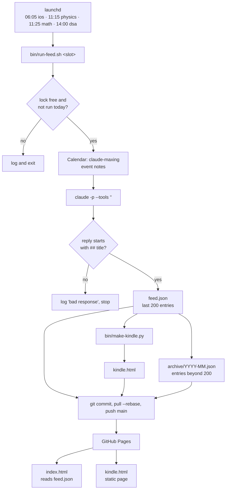

# the-feed

Four daily prompts run on a Mac and publish to a GitHub Pages page. Physics, math and dsa are written for a general reader; `ios` is its own flavor for a senior iOS engineer, shown under its own filter on the page.

| Slot | Time (IST) | Calendar event it reads |
|---|---|---|
| ios | 06:05 | `/ios/maxing/cheat-sheet` |
| physics | 11:15 | `/physics/maxing/cheat-sheet` |
| math | 11:25 | `/math/maxing/cheat-sheet` |
| dsa | 14:00 | `/dsa/maxing/cheat-sheet` |

Each run reads the event notes from the `claude-maxing` calendar, sends them to Claude (`claude -p`),
appends the reply to `feed.json`, then commits and pushes. `index.html` renders `feed.json`;
`kindle.html` is a static, script-free copy of the latest three entries for e-ink browsers.

## How it fits together

> **This repo and page are public.** Everything Claude writes here can be read by anyone with the URL.
> Keep calendar notes free of private plans, finances, work-confidential details, links and credentials.

## Files

- `index.html`: the page (reads `feed.json`); answers are hidden behind "Show answer"
- `kindle.html`: generated on every run by `bin/make-kindle.py`; open https://akhileshamle.github.io/the-feed/kindle.html on a Kindle
- `feed.json`: the latest 200 entries (what the page shows)
- `archive/YYYY-MM.json`: older entries, moved out of `feed.json` by month instead of deleted
- `bin/run-feed.sh`: one run: `bash bin/run-feed.sh <physics|math|dsa|ios>`
- `bin/archive-prompt.sh`: saves a slot's current Calendar note to `prompts/archive/<date>-<slot>.md`: `bash bin/archive-prompt.sh <physics|math|dsa|ios>`
- `prompts/archive/`: old Calendar notes (prompts), one dated file each; kept when a note is replaced (claude.ai artifact links are replaced by a placeholder, since the repo is public)
- `bin/make-kindle.py`: rebuilds `kindle.html` from `feed.json` (`python3 bin/make-kindle.py`)
- `install.sh`: installs or removes the daily launchd jobs (one per slot)
- `logs/`, `bin/feed.env`, `.lock`: local only, git-ignored

## Setup (once)

1. Install Claude Code and sign in (`claude`), then check `claude --version`.
2. Clone this repo to **`~/Developer/the-feed`**. Do not use Documents, Desktop or Downloads: macOS blocks scheduled jobs from reading them.
3. Sign git in to GitHub over HTTPS with a fine-grained token limited to this repo (Contents: read and write). The macOS Keychain stores it on the first push.
4. Turn on Pages: Settings, Pages, deploy from branch `main`, folder `/ (root)`.
5. Test: `bash bin/run-feed.sh physics`, allow the Calendar prompt, and check `logs/run.log` for `published`.
6. Schedule: `bash install.sh`.

## Everyday commands

Run from `~/Developer/the-feed`.

| Do this | Command |
|---|---|
| Check recent runs | `tail -5 logs/run.log` |
| Run one now | `bash bin/run-feed.sh physics` |
| Run again on a day it already ran | `FORCE=1 bash bin/run-feed.sh physics` |
| Dry run, no push | `SKIP_PUSH=1 bash bin/run-feed.sh physics` |
| See job status (exit code `0` is fine, `126` means blocked) | `launchctl list \| grep thefeed` |
| Test the scheduled path | `launchctl kickstart gui/$(id -u)/com.thefeed.physics` |
| Stop all jobs | `bash install.sh --uninstall` |
| Start or reinstall all jobs | `bash install.sh` |
| Pause one job | `launchctl bootout gui/$(id -u)/com.thefeed.physics` |

## Changing things

- **A prompt, every day:** first save the old note with `bash bin/archive-prompt.sh <slot>`, then edit the notes of the recurring event in the `claude-maxing` calendar and choose "All events".
- **A prompt, one day only:** add a separate one-day event on that day in `claude-maxing`, with the slot keyword in the title (for example `/physics/maxing/special`) and the prompt in its notes. A one-day event that starts on the run's day wins over the recurring one; one-day events on other days are ignored. Delete it afterwards or leave it, since it only applies on its own day. `logs/run.log` shows which one a run used (`notes from recurring event` or `notes from one-day event of …`).
- **Sync first:** the run reads whatever Calendar has locally, so edit the evening before rather than minutes before the run.
- **A time:** edit the `JOBS` list in `install.sh`, then run `bash install.sh`.
- **A new slot:** add a `case` branch in `bin/run-feed.sh` and a line in `JOBS`.
- **Moved the folder or reinstalled Claude:** run `bash install.sh` again.

## Cost

Each run calls `claude -p` with a lean setup: no tools, skills, MCP servers or user plugins (`--tools "" --disable-slash-commands --strict-mcp-config --setting-sources project`). Without those flags every run loads about 90,000 tokens of plugin and skill context around a prompt of about 700 tokens; with them it is about 4,000.

- Models: `sonnet` for physics, math and dsa; `opus` for ios. To change them, add `CLAUDE_MODEL=opus` or `CLAUDE_MODEL_IOS=sonnet` to `bin/feed.env` (kept when you re-run `install.sh`).
- A run costs roughly 1 to 3 cents on Sonnet by the CLI's own estimate. Test runs cost the same, so use `SKIP_PUSH=1` and the once-a-day skip sparingly.
- If a future Claude Code version drops one of the flags, the log shows `claude failed` and nothing is published.

## When something fails

Look at `logs/run.log` and `logs/launchd-<slot>.err` first.

| Message | Likely cause and fix |
|---|---|
| `osascript failed` | Calendar access blocked. System Settings, Privacy & Security, Automation. |
| `no notes found` | Event title or calendar name changed, or the matching event has empty notes. |
| `claude failed` | Login expired. Run `claude` once to sign in. |
| `push failed` | Token expired or revoked. See below. |
| `Operation not permitted`, exit `126` | Folder is in a macOS-protected location. Move it to `~/Developer`. |
| Push rejected | `git pull --rebase origin main`, then `git push`. |
| `rebase failed` | Remote has a conflicting change. The commit is kept locally; run `git pull --rebase origin main`, fix, `git push`. |
| `bad response, not published` | Claude's reply did not start with a `##` title (often a login or CLI error). Run `claude` to check. |
| `already ran today` | That slot already has an entry for today. Use `FORCE=1` to run again. |
| `lock busy` | Another run held `.lock` for 5 minutes. If none is running, `rmdir .lock`. |

### Renewing the token

1. Create a new fine-grained token limited to this repo, with Contents set to read and write.
2. Clear the old one: `printf "protocol=https\nhost=github.com\n\n" | git credential-osxkeychain erase`
3. Run `git push` and enter your GitHub username and the new token.

## How it behaves

- Each slot publishes at most once a day; runs wait for each other, so jobs that fire together on wake don't clash.
- The Mac must be awake and logged in. A locked screen is fine.
- Keep the local repo on `main`. Runs use whatever branch is checked out, so a run on another branch commits there and nothing reaches the page, even though the log says `published`.
- A run missed while the Mac sleeps happens on wake. A run missed while it is off is skipped.
- Jobs reload on their own after a restart, once you log in.

## Design note

Runs push straight to `main`. A branch, automated checks and auto-merge version was tried and dropped:
it added several GitHub-side settings and failure points for a small personal feed.
If it is ever revisited, store one file per run instead of one shared `feed.json`, so parallel branches never conflict.

## Taking it down

1. `bash install.sh --uninstall`
2. Delete the repo, or make it private, in GitHub Settings, Danger Zone. The page goes offline either way.
3. Delete the token in GitHub Settings, Developer settings, Fine-grained tokens.
4. Delete the local folder if you want it gone.